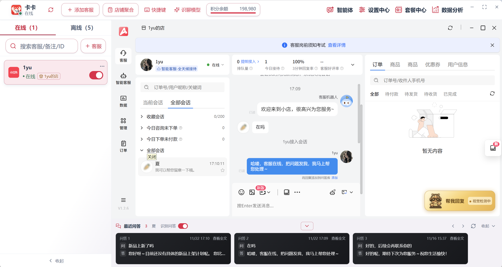
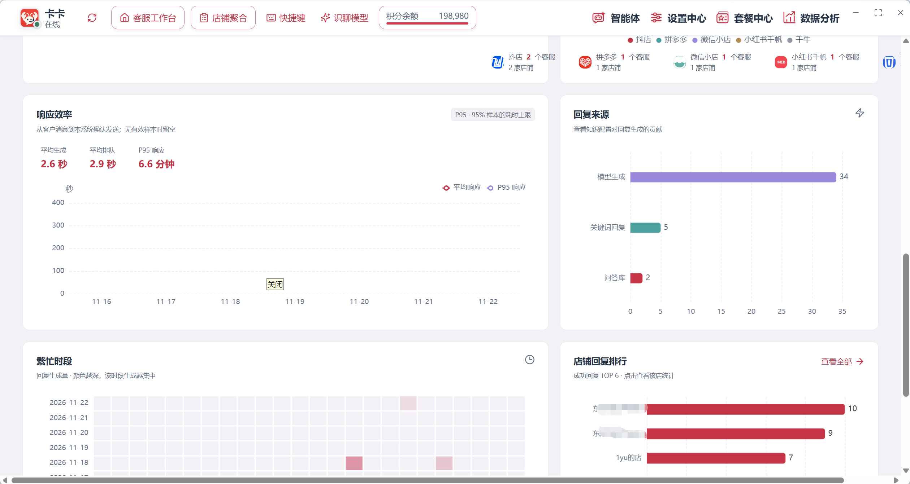
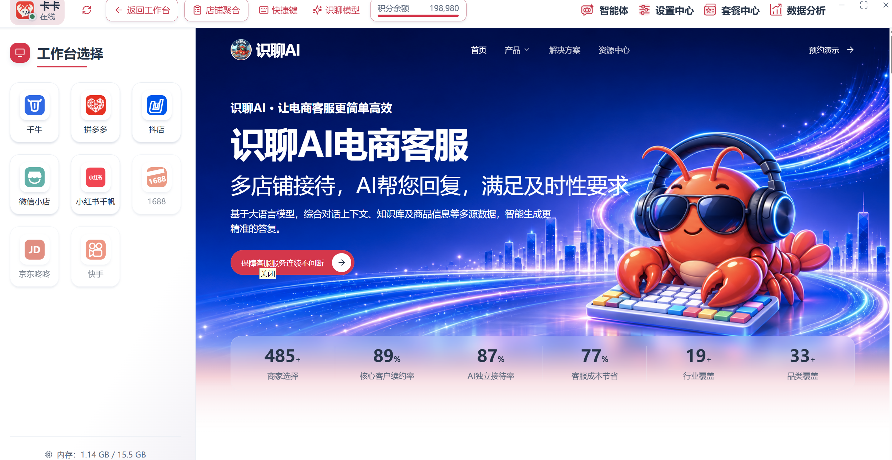
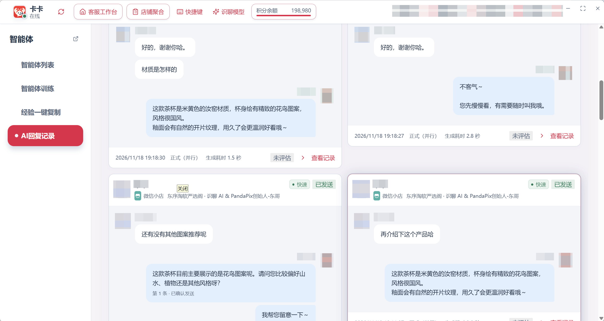

# ShiLiao AI E-commerce Customer Service - Qianniu, Duoduo & Douyin Shop Aggregated Version

#### Introduction

This is one of the open-source projects delivered for FDE, a brand e-commerce seller. The initial version of our production implementation is open-sourced here. It enables developers to connect domestic large language models such as DeepSeek, Baidu Wenxin, Qwen, Doubao with RAG for daily e-commerce customer service operations and auto-replies.

The aggregated version currently supports: Taobao, Pinduoduo, Douyin Shop, WeChat Mini Store, and Xiaohongshu Qianfan, with parallel reply capability.

Future roadmap: JD Dingdong and Kuaishou integration. Feel free to share product suggestions or ticket management requirements. Continuous updates will be maintained.

#### Environment Setup

`npm ci`

1. Pre-deployment Preparation
Complete service connection, account configuration and runtime parameters following project documentation.
2. Build frontend assets
`npm run build`
3. Launch client
`npm start`
4. Build Windows installer
`npm run dist`
5. Verify runtime environment
Install the generated client, finish login and store connection.

#### Demo

Demo URL: [https://wx.fensiguanjia.com](https://wx.fensiguanjia.com). Free registration available.

# ShiLiao AI Customer Service (shopAiService)｜Multi-platform E-commerce AI Customer Service & Intelligent Reception Workbench

**Consolidate multi-store reception, product knowledge and AI replies into one workbench to boost e-commerce customer service efficiency.**

ShiLiao AI Customer Service (shopAiService) is a Windows desktop AI customer service application built for e-commerce merchants, brand operation teams and customer support teams. Covering service scenarios for Douyin Shop, WeChat Mini Store, Pinduoduo, Xiaohongshu Qianfan and Qianniu, it provides aggregated multi-store management, intelligent replies, product knowledge base, human assistance, auto reception and reply performance review.

This repository is for public preview, binary distribution and requirement discussion. Compiled builds with **partial features** will be released. This document describes full product capabilities. Actual supported platforms, available features and usage terms for public releases are subject to the corresponding Release notes.

[About Product](#product) · [Supported Platforms](#platforms) · [Core Features](#features) · [Quick Start](#quick-start) · [FAQ](#faq) · [Roadmap](#roadmap) · [Contact](#contact)

## What is ShiLiao AI Customer Service?

ShiLiao AI Customer Service is e-commerce intelligent customer service software combining a **multi-platform support workbench, store knowledge management and LLM response capabilities**. Merchants can centrally manage customer service accounts, organize product & service documents, and choose AI-assisted replies, response evaluation or auto reception according to business needs.

For inquiries such as "How to choose this product?", "What specifications are available?", "How to store it?", "What is the return & exchange policy?", ShiLiao AI Customer Service generates replies based on ongoing conversations and maintained knowledge base. For order issues requiring further confirmation, special commitments or dispute consultations, human agents can review and take over the conversation.

| Product Info | Details |
| --- | --- |
| Chinese Name | ShiLiao AI Customer Service, also known as ShiLiao AI E-commerce Customer Service |
| Project ID | shopAiService |
| Product Type | E-commerce AI customer service software, multi-store aggregated support workbench |
| Target Users | E-commerce merchants, brand operation teams, customer service teams, multi-store operators |
| Current Client | Windows desktop client |
| Core Capabilities | Cross-platform reception, AI replies, product knowledge base, Q&A training, human collaboration, operation analytics |
| GitHub Release Form | Compiled binaries with partial features. Scope is subject to release notes. |

### Suitable Business Scenarios

- **Daily product consultation**: Organize specifications, materials, usage and storage guides to help agents answer repetitive questions.
- **Multi-store operation**: Manage multiple service accounts within one unified workbench, eliminating frequent window switching.
- **Peak activity inquiries**: Offload common questions to AI, allowing human agents to focus on complex judgment & coordination tasks.
- **Off-hours reception**: Provide responses while the client remains running, following business hours and custom templates.
- **Customer service team training**: Reuse service experience with exemplary Q&A and high-quality reply samples.
- **Service quality review**: Inspect chat logs and human feedback, identify knowledge gaps and continuously optimize reception rules.

Merchants selling apparel & footwear, fresh food, beauty & personal care, digital appliances, home goods etc. may configure reception content based on their own product materials and service policies.

## Supported E-commerce Platforms

The full product integrates with the following platforms and workbenches:

| E-commerce Platform | Service Entry | Account & Workbench Management | Product Sync | AI Assistance & Auto Reception |
| --- | --- | --- | --- | --- |
| Douyin Shop / Douyin E-commerce | Feige Customer Service Workbench | Supported | Supported | Supported |
| WeChat Mini Store | WeChat Mini Store Service Workbench | Supported | Supported | Supported |
| Pinduoduo | Pinduoduo Merchant Service Workbench | Supported | Supported | Supported |
| Xiaohongshu | Xiaohongshu Qianfan Service Workbench | Supported | Supported | Supported |
| Taobao / Tmall | Qianniu Desktop Client | Supported | Supported | Supported |

The table describes integration scope of the full product. Feature details and runtime requirements vary across platforms. Qianniu currently mainly connects via individual service windows; client setup must be completed per release documentation before use. For public demo versions, check platform & feature lists in Releases.

ShiLiao AI Customer Service is an independent product. Platform names are used only to describe compatible scenarios. All related trademarks and names belong to their respective owners.

## Core Features

### 1. Multi-platform & Multi-store Customer Service Aggregation

Centralize customer service portals from different platforms into a single desktop workbench. View account, store and reception status, toggle AI participation for each account as needed.

- Centralized management of multiple service accounts with independent login sessions preserved.
- View status by store / agent, switch workbench and identify pending messages.
- Batch online, break and offline operations for supported web-based customer services, subject to platform API capabilities.

### 2. AI Intelligent Reply & Multi-turn Dialogue

AI generates replies based on recent chat history, product data, general Q&A and reception rules to handle continuous customer questions.

- Supports product consultation, pre-sales Q&A and store service policy explanation.
- Adjustable reply tone, length, quantity and sending pace.
- Multiple response modes for routine inquiries and complex cases.
- Image-aware assistance for supported conversation contexts.

### 3. Human Assistance, Performance Evaluation & Auto Reception

Merchants can adopt AI incrementally: start with AI assistance, evaluate results, then decide whether to enable full auto reception.

Human operations, draft protection, pause & stop controls allow agents to take over whenever necessary.

### 4. Product Library & Store Knowledge Base

Centralize scattered product materials and service experience into maintainable knowledge to support reliable replies.

- Sync on-sale products from supported platforms for centralized lookup.
- Supplement specifications, usage instructions, storage guides and FAQs for each product.
- Maintain global store Q&A, delivery notes and after-sales policies.
- Supports knowledge editing, human validation and product export; export formats depend on build version.

Example use cases: food merchants maintain ingredients, shelf life and storage rules; apparel merchants organize size charts, fabric and selection Q&A; digital merchants add model specs, compatibility and user guides.

### 5. Agent Configuration, Demonstration Training & Knowledge Reuse

Build dedicated reception rules for your store business and improve replies using real Q&A data accumulated in daily work.

- Configure agent persona, writing style and service requirements.
- Manage training content scoped by store, agent or product.
- Validate reply quality with mock questions and multi-turn conversations.
- Archive high-quality replies as examples and submit feedback on unsatisfactory outputs.
- Reuse knowledge across applicable scopes to reduce duplicated configuration work.

### 6. Roadmap

1. Add JD Dingdong support
2. Kuaishou performance optimization: full compatibility with vision models

---