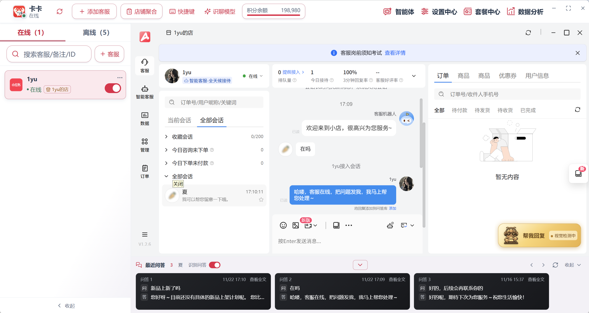
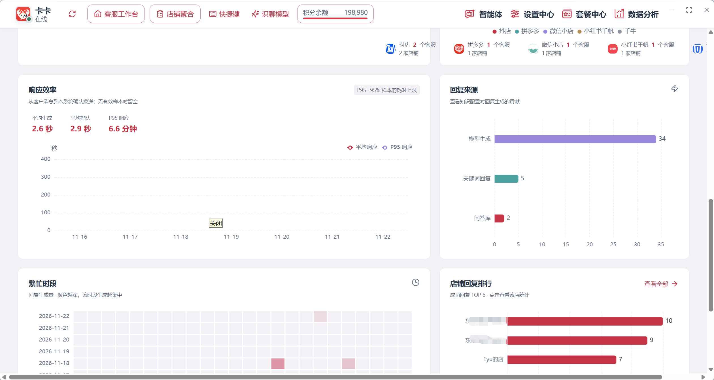
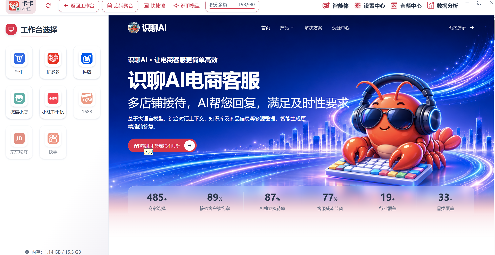
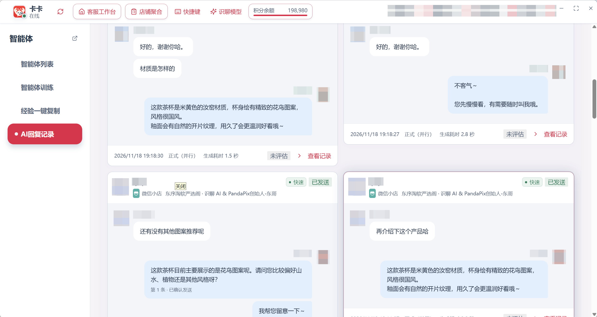

# 识聊AI电商客服-千牛多多抖店开源版

#### 介绍
本产品是帮某品牌电商卖家FDE服务落地后的开源产品之一，旨在将落地实施的初版开源：帮助开发者通过桥接国产大模型如DeepSeek、百度文心、Qwen、豆包、RAG接入到电商客服的日常运营+回复。
目前聚合版本已支持：淘宝、拼多多、抖店、微信小店、小红书千帆，且支持并行回复。
后续迭代计划接入：京东叮咚、快手。有好的产品建议或工单管理需求，欢迎大家多交流，会持续不断更新。

#### 运行环境
npm ci
1. 运行前准备
按项目说明完成服务连接、产品账号及运行参数配置

2. 编译前端资源
npm run build

3. 启动客户端
npm start

4. 生成 Windows 安装包
npm run dist

5 验证运行环境
安装生成的客户端，完成产品登录和店铺接入

#### 体验demo
演示地址：https://kf.ai-bool.com 可自行注册体验

# 识聊AI客服（shopAiService）｜多平台电商 AI 客服与智能接待工作台

**把多店铺接待、商品知识和 AI 回复放进一个工作台，让电商客服更高效。**

识聊AI客服（shopAiService）是一款面向电商商家、品牌运营团队和客服团队的 Windows 桌面 AI 客服产品。围绕抖店、微信小店、拼多多、小红书千帆及千牛等电商接待场景，提供多店铺聚合管理、智能回复、商品知识库、人工辅助、自动接待和回复效果复盘能力。

本仓库用于公开体验、版本分发与需求交流，计划提供**部分功能的编译版本**。本文介绍完整产品的主要能力；公开版本实际开放的平台、功能和使用条件，请以对应 Release 的发布说明为准。

[了解产品](#product) · [支持平台](#platforms) · [核心功能](#features) · [下载体验](#quick-start) · [常见问题](#faq) · [迭代计划](#roadmap) · [需求与交流](#contact)

## 识聊AI客服是什么？

识聊AI客服是一款将**多平台客服工作台、店铺知识管理和大语言模型应答能力**结合起来的电商智能客服软件。商家可以集中管理客服账号，整理商品和服务资料，再根据业务需要选择 AI 辅助回复、评估回复效果或启用自动接待。

对于“这款商品怎么选”“有哪些规格”“如何保存”“退换货规则是什么”等咨询，识聊AI客服可结合当前对话与已维护的知识生成答复。遇到需要进一步确认的订单问题、特殊承诺或争议咨询，客服可以参与核对并接管处理。

| 产品信息 | 说明 |
| --- | --- |
| 中文名称 | 识聊AI客服，也称识聊AI电商客服 |
| 项目标识 | shopAiService |
| 产品类型 | 电商 AI 客服软件、多店铺聚合客服工作台 |
| 适用人群 | 电商商家、品牌运营团队、客服团队、多店铺经营者 |
| 当前客户端 | Windows 桌面客户端 |
| 主要能力 | 多平台接待、AI 回复、商品知识库、问答训练、人工协作、运营分析 |
| GitHub 发布形式 | 部分功能的编译版本，开放范围以发布说明为准 |

### 适合哪些业务场景？

- **日常商品咨询：**整理规格、材质、用法、储存方式等资料，帮助客服回答重复问题。
- **多店铺运营：**在统一工作台管理多个客服账号，减少反复切换工作窗口的操作。
- **活动与咨询高峰：**让 AI 分担常见咨询，客服集中处理需要判断和协调的问题。
- **非工作时段接待：**结合营业时间和专属话术，在客户端持续运行的条件下提供应答。
- **客服团队培训：**用典型问答和优秀回复建立示范，让服务经验可以复用。
- **服务质量复盘：**查看回复记录与人工反馈，发现知识缺口，持续调整接待规则。

服饰鞋包、食品生鲜、美妆个护、数码家电、家居日用等商家，可围绕自身商品资料与服务政策配置接待内容。

## 支持哪些电商平台？

完整产品当前已接入以下平台和工作台：

| 电商平台 | 接待入口 | 账号与工作台管理 | 商品信息同步 | AI 辅助与自动接待 |
| --- | --- | --- | --- | --- |
| 抖店 / 抖音电商 | 飞鸽客服工作台 | 已接入 | 已接入 | 已接入 |
| 微信小店 | 微信小店客服工作台 | 已接入 | 已接入 | 已接入 |
| 拼多多 | 拼多多商家客服工作台 | 已接入 | 已接入 | 已接入 |
| 小红书 | 小红书千帆客服工作台 | 已接入 | 已接入 | 已接入 |
| 淘宝 / 天猫 | 千牛桌面客户端 | 已接入 | 已接入 | 已接入 |

上表表示完整产品的接入范围。各平台的功能细节和运行条件存在差异；千牛当前以单个客服窗口接入为主，使用前需按版本说明完成客户端设置。公开体验版请查看 Release 中的平台与功能清单。

识聊AI客服是独立产品。文中平台名称用于说明适配场景，相关名称与商标归各自权利方所有。

## 核心功能

### 1. 多平台、多店铺客服聚合

将不同平台的客服入口集中到一个桌面工作台，查看账号、店铺及接待状态，并按业务需要开启或关闭账号的 AI 参与。

- 多个客服账号集中管理，保留各账号独立的登录会话。
- 按店铺与客服查看状态、切换工作台、识别待处理消息。
- 为已支持的网页客服提供批量上线、小休、离线等快捷操作，具体以平台能力为准。

### 2. AI 智能回复与多轮对话

AI 结合近期会话、商品资料、通用问答和接待规则生成回复，帮助客服衔接顾客的连续提问。

- 支持商品咨询、售前问答和店铺服务政策说明。
- 可调整回复口吻、篇幅、条数与发送节奏。
- 提供不同应答档位，适应日常咨询和较复杂问题。
- 在支持的会话场景中结合图片等可识别内容辅助理解。

### 3. 人工辅助、效果评估与自动接待

商家可以按使用阶段逐步引入 AI：先人工辅助，再评估效果，最后选择是否启用正式自动接待。

人工操作与草稿保护、暂停和停止控制，帮助客服在需要时参与处理。

### 4. 商品信息库与店铺知识库

把分散的商品资料和服务经验整理成可维护的知识，为回复提供业务依据。

- 同步支持平台的在售商品，集中检索和查看商品信息。
- 按商品补充规格、使用说明、保存方式、常见问题等资料。
- 维护店铺通用问答、配送说明和售后政策。
- 支持资料整理、人工确认及商品信息导出，具体格式以版本为准。

例如，食品商家可以维护配料、保质期和储存方式；服饰商家可以整理尺码、面料和选款问答；数码商家可以补充型号、适配条件和使用说明。

### 5. 智能体配置、示范训练与经验复用

围绕店铺业务建立专属接待规则，用真实工作中积累的问答经验完善回复。

- 配置智能体的服务角色、表达风格和接待要求。
- 按店铺、客服或商品等范围维护训练内容。
- 使用模拟提问和多轮问答检查回复效果。
- 将优秀回复整理为示范，对需要改进的内容提交反馈。
- 在适用范围内复制经验，减少重复配置工作。

### 6. 迭代计划
1.加入京东叮咚支持
2.快手效率速度优化：视觉模型全面兼容
